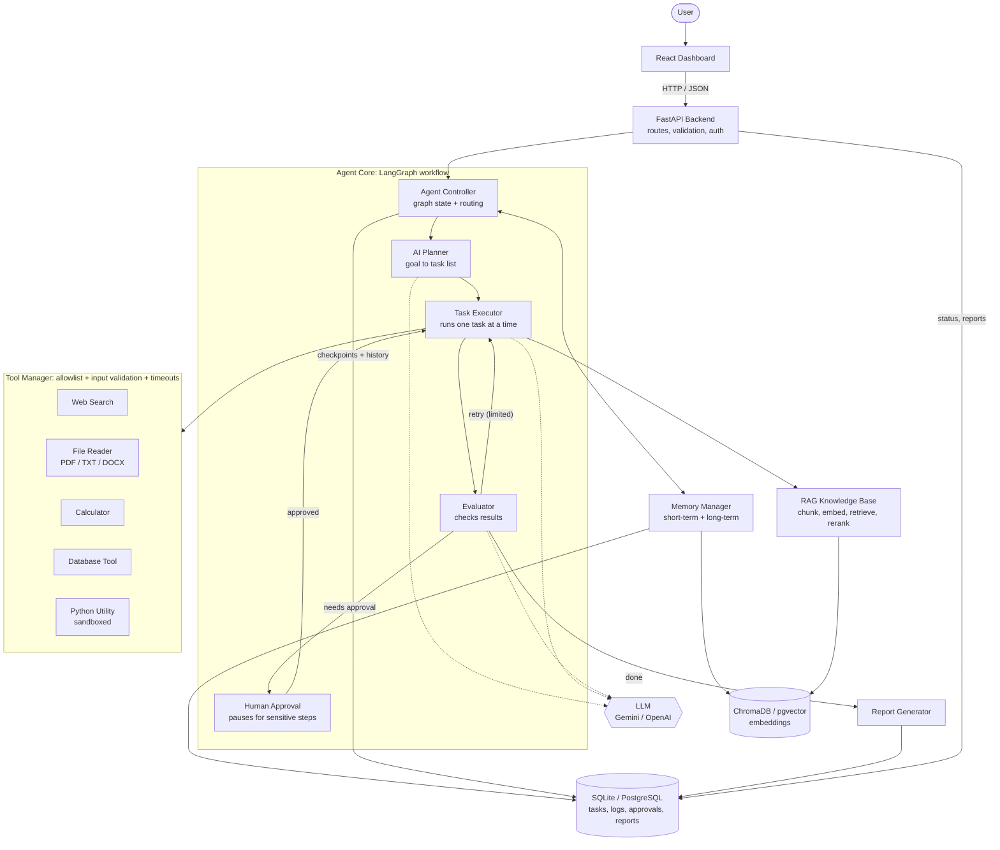
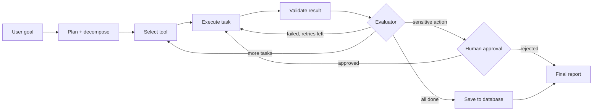
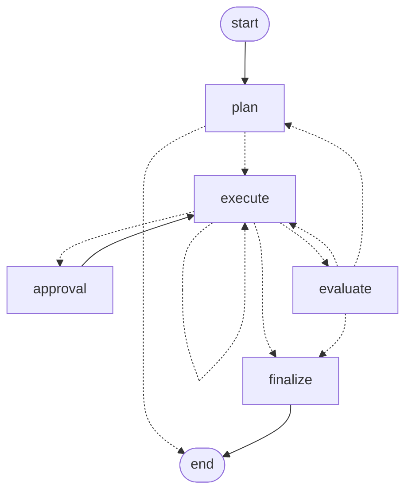

# Autonomous AI Agent

A personal autonomous AI agent built with **Python, FastAPI, LangGraph and RAG**.
Give it a goal in plain English. It plans the work, picks tools, runs the steps,
checks its own results, asks you before anything sensitive, and writes a report.

> Example goal: *"Research the top 10 AI Engineer fresher jobs in Bengaluru and Hyderabad,
> compare their required skills, generate a report, and save it in the database."*

**Status:** Phase 14 of 15 complete (tested end to end: unit, integration, security, performance, real-browser E2E, CI): a Next.js dashboard on a multi-user FastAPI backend (JWT login, refresh-token rotation, per-user data) running autonomous LangGraph agents with self-evaluation, a full safety layer (see [SECURITY.md](SECURITY.md)), and permanent run history in MySQL with Alembic migrations.

---

## Architecture



### Agent workflow



Workflow state is checkpointed after every step, so a run can pause (e.g. waiting for
approval) and resume later, even after a server restart.

### LangGraph workflow (generated from the compiled graph)



Dotted arrows are conditional edges. `execute` runs one wave of parallel tasks per visit, so
a checkpoint is saved after every wave. `approval` pauses the run with `interrupt()`; the run
resumes, even after a server restart, when a human approves or rejects the waiting tasks.
`evaluate` checks every number and URL in reports against the sources, asks an LLM judge to
score each result, then accepts, sends specific tasks back with feedback, or re-plans (bounded).

---

## Tech stack

| Area | Technologies |
|---|---|
| Language | Python 3.11+, async, type hints, Pydantic |
| LLM | Google Gemini (default) or OpenAI, LangChain, LangGraph, structured outputs, tool calling |
| Backend | FastAPI, SQLAlchemy, Pydantic Settings, JWT (PyJWT), bcrypt (pwdlib), CORS, request ids |
| Data | MySQL 8 (or PostgreSQL / SQLite), SQLAlchemy 2 ORM, Alembic migrations, ChromaDB |
| RAG | PyPDF, text splitting, embeddings, semantic search, reranking |
| Frontend | Next.js 16 (App Router), React 19, JavaScript, react-markdown, Vitest + Testing Library |
| Ops | Docker, Docker Compose, GitHub, pytest |

---

## Project structure

Files marked *(Phase N)* are documented placeholders that get implemented in that phase.

```
autonomous-ai-agent/
│
├── app/
│   ├── main.py                  # FastAPI app factory + startup/shutdown (lifespan)
│   ├── config.py                # typed settings loaded from .env
│   ├── cli.py                   # terminal playground: python -m app.cli ...
│   ├── logging_config.py        # one log format for the whole app
│   ├── timeutils.py             # UTCDateTime: API timestamps always carry a time zone
│   │
│   ├── auth/
│   │   ├── security.py          # bcrypt hashing, JWT access tokens, refresh token hashing
│   │   ├── service.py           # register, login, refresh rotation + reuse detection, logout
│   │   ├── context.py           # the current user (ContextVar), follows background work
│   │   ├── throttle.py          # login brute-force protection
│   │   └── schemas.py           # RegisterRequest, TokenPair, AuthUser
│   │
│   ├── agent/
│   │   ├── planner.py           # goal -> validated plan (repair loop)
│   │   ├── plan_graph.py        # DAG checks, topological order, parallel waves
│   │   ├── schemas.py           # Task, Plan, PlanningResult
│   │   ├── executor.py          # runs plans: parallel waves, retries, limits, audit
│   │   ├── evaluator.py         # LLM judge + rules -> accept / retry with feedback / re-plan
│   │   ├── evidence.py          # are report numbers & URLs backed by sources?
│   │   └── workflow.py          # LangGraph state machine, approvals, checkpoints
│   │
│   ├── tools/
│   │   ├── catalog.py           # allowlist of tools + approval rules
│   │   ├── registry.py          # the single safety gate for every tool call
│   │   ├── base.py              # AgentTool, ToolResult, ToolError
│   │   ├── web_search.py        # Tavily / DuckDuckGo
│   │   ├── calculator.py        # safe AST calculator (no eval)
│   │   ├── file_reader.py       # PDF / DOCX / TXT, locked to data/documents
│   │   ├── database_tool.py     # save / query records (no raw SQL)
│   │   ├── python_tool.py       # restricted Python, needs approval
│   │   ├── knowledge_base_tool.py  # search_knowledge_base (RAG) for the agent
│   │   ├── llm_tools.py         # llm_analysis + generate_report (reasoning tools)
│   │   └── email_tool.py        # send_email, outbox mode (.eml files, never sent)
│   │
│   ├── memory/
│   │   ├── short_term.py        # working memory + conversation store
│   │   ├── long_term.py         # lasting facts, relevance/importance/recency
│   │   ├── manager.py           # recall, extraction, summarization
│   │   ├── schemas.py           # memory records and operations
│   │   └── vector_store.py      # ChromaDB wrapper + semantic memory index
│   │
│   ├── rag/
│   │   ├── embeddings.py        # local MiniLM (ONNX) or Gemini embeddings
│   │   ├── ingestion.py         # load, clean, chunk, hash, embed, store
│   │   └── retrieval.py         # vector search, rerank, cited answers
│   │
│   ├── safety/
│   │   ├── secrets.py           # redact API keys, passwords, card numbers
│   │   ├── permissions.py       # policy: disabled tools, email allowlist, no secrets out, budgets, rate limits
│   │   ├── approval.py          # approval audit trail (exact arguments + SHA-256 fingerprint)
│   │   └── injection.py         # flags outside content that tries to instruct the AI
│   │
│   ├── database/
│   │   ├── models.py            # SQLAlchemy tables (maps the hand-made MySQL schema)
│   │   ├── connection.py        # engine, sessions, UTC sessions, open_database()
│   │   ├── migrations.py        # Alembic helpers: current vs head revision, upgrade
│   │   └── crud.py              # RunRepository: runs, steps, tool logs, history
│   │
│   ├── llm/
│   │   ├── client.py            # provider-independent model factory
│   │   ├── service.py           # chat, structured output, tool-calling loop
│   │   ├── prompts.py           # all prompt templates in one place
│   │   ├── schemas.py           # GoalAnalysis, tool-run results
│   │   └── example_tools.py     # small demo tools for function calling
│   │
│   ├── api/
│   │   ├── routes.py            # REST endpoints
│   │   ├── auth.py              # /auth endpoints + require_user / require_admin guards
│   │   ├── middleware.py        # request ids, access log, safe 500 responses
│   │   └── schemas.py           # request/response models
│   │
│   └── services/
│       └── report_generator.py  # Markdown reports from task results
│
├── alembic/                     # migrations: 0001 original schema, 0002 agent extensions, 0003 auth
├── alembic.ini                  # Alembic config (the URL comes from .env, not this file)
├── docs/db/original_schema.sql  # the original hand-made tables (restore point)
├── frontend/                    # Next.js dashboard (Phase 13)
│   ├── app/                     # pages: login, register, (app)/ dashboard, runs/[runId], chat, memories, knowledge
│   ├── components/              # ApprovalPanel, PlanSteps, RunHistory, Markdown (safe), NavBar, ui
│   ├── lib/                     # api.js (tokens, refresh), auth.jsx (session context), useApi.js (polling)
│   ├── tests/                   # Vitest + Testing Library (vi.fn mocks), coverage thresholds
│   ├── e2e/                     # Playwright: real Chromium through the real stack
│   └── next.config.mjs          # /api proxy to FastAPI, security headers
├── tests/                       # pytest (unittest.mock for LLM/network)
│   ├── integration/             # full user journeys: HTTP + auth + workflow + DB + tools
│   ├── security/                # route inventory, IDOR, mass assignment, fuzzing, Hypothesis properties
│   ├── performance/             # query counts (N+1), query plans, latency budgets, concurrency
│   ├── support/                 # scripted LLM + full-stack harness shared by the suites
│   └── e2e_server.py            # backend for the Playwright tests (fresh temp DB, scripted LLM)
├── scripts/load_test.py         # load test against a running server
├── .github/workflows/ci.yml     # CI: lint, scans, all tests, MySQL, build, E2E
├── .env                         # your secrets (git-ignored)
├── .env.example                 # template for .env (committed)
├── .gitignore
├── pyproject.toml               # project metadata + pytest config
├── requirements.txt             # pinned runtime dependencies
├── requirements-dev.txt         # + test and security tools
├── README.md
└── SECURITY.md                  # threat model, controls, accepted risks
```

---

## Quick start (Windows PowerShell)

```powershell
git clone https://github.com/Deva-Raj-kumar/autonomous-ai-agent.git
cd autonomous-ai-agent
python -m venv venv
.\venv\Scripts\Activate.ps1
pip install -r requirements-dev.txt
copy .env.example .env      # then put your real GOOGLE_API_KEY (and DATABASE_URL) in .env
alembic upgrade head        # create / upgrade the database tables
python -m app.cli users create you@example.com yourname --admin --adopt-local   # your account
pytest                      # run the tests
uvicorn app.main:app --reload
```

Open <http://127.0.0.1:8000/docs> for interactive API docs, or <http://127.0.0.1:8000/health>.
In `/docs`, click **Authorize**, enter your email as *username* and your password: every
request you try from the page then carries your token.

Use the API from a script:

```powershell
$t = Invoke-RestMethod -Method Post http://127.0.0.1:8000/auth/login -Body @{username='you@example.com'; password='your password'}
$h = @{Authorization = "Bearer $($t.access_token)"}
Invoke-RestMethod http://127.0.0.1:8000/auth/me -Headers $h
Invoke-RestMethod http://127.0.0.1:8000/memories -Headers $h
```

| Endpoint | Purpose |
|---|---|
| `POST /auth/register` | create an account (if `ALLOW_REGISTRATION=true`) |
| `POST /auth/login` | email + password -> access token (15 min) + refresh token |
| `POST /auth/refresh` | new token pair; the old refresh token stops working |
| `POST /auth/logout` | end this login |
| `GET /auth/me` | who am I |
| `GET /health`, `GET /health/ready` | liveness, and readiness (database reachable) |

Everything else needs `Authorization: Bearer <access token>` and only ever sees **your** data.

Try the LLM from the terminal:

```powershell
python -m app.cli models                 # models your key can use
python -m app.cli goal "Research AI fresher jobs in Bengaluru and write a report"
python -m app.cli tools "What time is it in Tokyo? Also what is 23.5 * 19?"
python -m app.cli plan "Compare AI fresher jobs in Bengaluru and Hyderabad and save a report"
python -m app.cli list-tools
python -m app.cli tool calculator expression="(45000 + 52000) / 2"
python -m app.cli tools "Read sample_job_description.txt and compute the midpoint of its salary range"
python -m app.cli talk "I'm Ravi and I want to become an LLM engineer" --session ravi
python -m app.cli repl --session ravi    # interactive chat with memory
python -m app.cli memories               # see (and delete) what the agent remembers
python -m app.cli kb ingest              # index files in data/documents
python -m app.cli kb ask "What salary does the AI engineer job offer?"
python -m app.cli run "Compare the two opportunities in my knowledge base and recommend one"
python -m app.cli runs                  # runs survive restarts
python -m app.cli approve <run_id> t1   # approve a paused task
python -m app.cli history <run_id>     # steps + every tool call, from the database
python -m app.cli db                   # which database, and is the schema up to date?
python -m app.cli users list           # accounts; also: promote / demote / disable / enable <email>
```

### Dashboard (Next.js)

Needs Node.js 20+. In a second terminal, with the backend running on port 8000:

```powershell
cd frontend
npm install        # first time only
npm run dev        # http://localhost:3000
npm test           # frontend tests
```

The browser only talks to Next.js; it forwards `/api/*` to FastAPI (`API_URL`, default
`http://127.0.0.1:8000`; see `frontend/.env.local.example`). The access token lives in
memory, and the refresh token in an httpOnly cookie that page scripts can't read.

### Testing

| Command | What it runs |
|---|---|
| `pytest` | everything below except live LLM and MySQL tests (~580 tests) |
| `pytest -m integration` / `-m security` / `-m perf` | one category |
| `pytest --cov=app` | with line + branch coverage (fails under 88%) |
| `ruff check app tests scripts alembic` · `bandit -r app` · `python -m pip_audit -r requirements.txt` | lint and security scans |
| `cd frontend; npm test` · `npm run test:coverage` | frontend unit tests |
| `cd frontend; npm run e2e` | real-browser tests (starts its own backend + dashboard) |
| `python scripts/load_test.py --users 20 --seconds 30` | load test a running server (local/staging only) |

Integration, security, E2E and load tests use a **scripted LLM** (`tests/support/scripted_llm.py`):
no API key, no quota, the same answer every time.

Run live LLM tests (uses your quota): `$env:RUN_LIVE_TESTS="1"; pytest -m live`

Run the MySQL test (uses a scratch database it creates and drops): `$env:RUN_MYSQL_TESTS="1"; pytest -m mysql`

**Already have tables made by hand?** Run `alembic stamp 0001` once (tells Alembic they match the baseline), then `alembic upgrade head`. Back up first.

macOS/Linux: use `source venv/bin/activate` and `cp .env.example .env`.

---

## Roadmap

- [x] 1. Project setup, config, health API, tests
- [x] 2. LLM integration (structured outputs, function calling)
- [x] 3. AI planner (task decomposition, dependencies)
- [x] 4. Tools (calculator, web search, file reader, DB, python)
- [x] 5. Memory system
- [x] 6. RAG (ChromaDB, chunking, retrieval, reranking)
- [x] 7. Autonomous execution engine (retries, limits, logging)
- [x] 8. LangGraph workflow + checkpointing
- [x] 9. Self-evaluation
- [x] 10. Safety: human-in-the-loop, permissions, prompt-injection defense
- [x] 11. Database integration (SQLAlchemy, MySQL, Alembic migrations)
- [x] 12. Full FastAPI backend + auth (JWT, refresh rotation, per-user data)
- [x] 13. Next.js dashboard (live runs, approve-what-you-see, chat, memories, knowledge)
- [x] 14. Testing (integration, security, performance, E2E, CI)
- [ ] 15. Docker + cloud deployment

## Security principles

The agent only uses allowlisted tools with validated inputs and timeouts. It never runs
arbitrary shell commands, reads files outside allowed folders, reveals API keys, or sends
emails, submits applications, deletes files or makes payments without explicit human
approval. Web pages and uploaded documents are treated as untrusted data.
